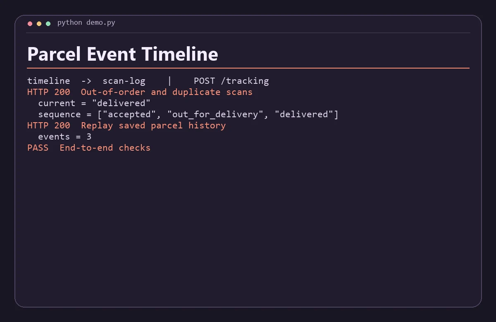

# Parcel Event Timeline

Replay shipment scans into a delivery timeline that handles duplicates and events arriving out of order.



## Run the demo

Install Python 3.11+, Node.js 22+, then run this from the repository root.

```sh
python demo.py
```

The command starts both services on separate loopback ports, sends the requests in `examples.json`, checks the responses, and shuts down the processes. Use `python3` if that is how your system exposes Python.

## Run the services with Docker Compose

```sh
docker compose up -d --build
python demo.py --base-url http://127.0.0.1:8080
docker compose down
```

The API binds to loopback on port 8080 by default. Set `DEMO_PORT` and use the matching base URL to run another project alongside it. Set-up and service discovery follow the [Docker Compose networking documentation](https://docs.docker.com/compose/how-tos/networking/).

The worker owns the SQLite database. Compose keeps it in the `service-data` volume. Run `docker compose down -v` to reset that project's demo data. A native demo uses a temporary database. Start from fresh demo state before rerunning the scripted Compose checks.

## Architecture

Scan Log stores immutable parcel events in SQLite. Timeline replays the scans in timestamp order and derives the current parcel status. Retries with an identical event ID and body are idempotent.

| Service | Runtime | Operation |
| --- | --- | --- |
| `timeline` | JavaScript | Public demo API, `POST /tracking` |
| `scan-log` | Python | Internal service, `POST /scans` |

The two services exchange JSON over HTTP. Each has a `GET /health` endpoint for process readiness. Compose starts the API after the internal service passes its readiness probe. A gateway request returns HTTP 502 when its dependency is unavailable or fails unexpectedly. Invalid input returns HTTP 400. Domain conflicts return HTTP 409 where supported.

## API example

Send parcel and scans with id, at (ISO 8601 UTC) and status (accepted, in_transit, out_for_delivery, delivered). An empty scans array reads existing history. Conflicting reuse of an event ID returns HTTP 409.

From a running Compose stack, save this JSON as `input.json` and run the command below. On Windows use `curl.exe` if your shell aliases `curl`.

```json
{
  "parcel": "SC-204",
  "scans": [
    {
      "id": "c",
      "at": "2026-11-11T16:45:00Z",
      "status": "delivered"
    },
    {
      "id": "a",
      "at": "2026-11-11T08:00:00Z",
      "status": "accepted"
    },
    {
      "id": "b",
      "at": "2026-11-11T14:00:00Z",
      "status": "out_for_delivery"
    },
    {
      "id": "a",
      "at": "2026-11-11T08:00:00Z",
      "status": "accepted"
    }
  ]
}
```

```sh
curl -s -H "Content-Type: application/json" --data-binary @input.json http://127.0.0.1:8080/tracking
```

The response includes these fields.

```json
{
  "current": "delivered",
  "sequence": [
    "accepted",
    "out_for_delivery",
    "delivered"
  ]
}
```

## Scope

This is a local portfolio project using synthetic data. The APIs are intended for loopback and the private Compose network. A public deployment would need authentication, rate limits, and production observability.
